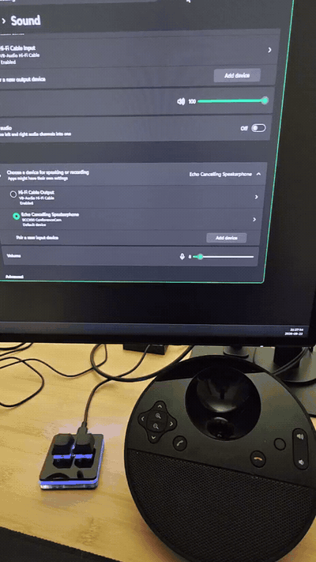
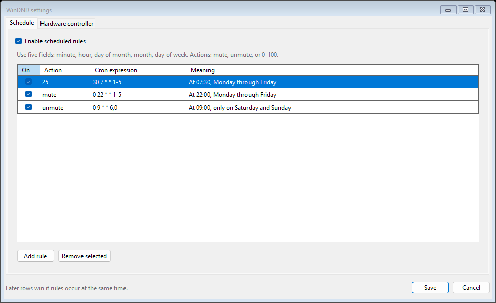
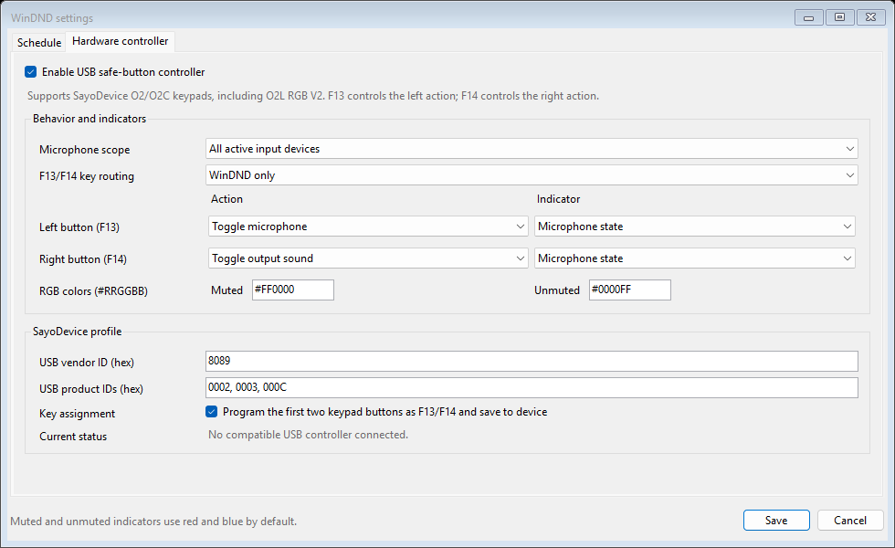
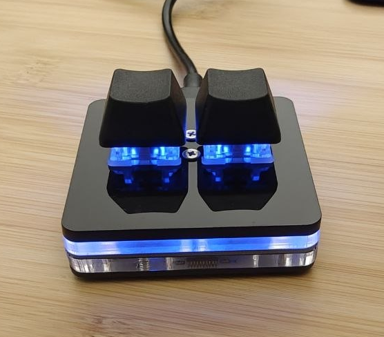

<p align="center"></p>
<h1 align="center">WinDND</h1>
<p align="center"><strong>Schedule Windows audio and give your microphone a physical safety switch.</strong></p>
<p align="center">
  <a href="https://github.com/nuvqe/WinDND/actions/workflows/build.yml"></a>
  <a href="https://github.com/nuvqe/WinDND/releases/latest"></a>
  <a href="#requirements"></a>
  <a href="https://dotnet.microsoft.com/"></a>
  <a href="LICENSE"></a>
</p>
<p align="center">
  <a href="https://github.com/nuvqe/WinDND/releases/latest">Download the latest MSI</a> ·
  <a href="https://github.com/nuvqe/WinDND/issues/new?template=bug_report.yml">Report a bug</a> ·
  <a href="https://github.com/nuvqe/WinDND/issues/new?template=feature_request.yml">Request a feature</a>
</p>

WinDND (Windows Do Not Disturb) is a lightweight tray application that controls every active Windows audio endpoint. It can mute, unmute, or set output volume on cron schedules, and it can turn a compatible two-button USB keypad into a visible microphone safety switch.

> [!IMPORTANT]
> USB keypad support uses the published SayoDevice O2/O2C protocol. The O2L RGB V2 with firmware 1.2.38 has been physically verified: both keys and the red/blue RGB indicators work reliably with WinDND. Complete the [hardware validation checklist](docs/hardware-validation.md) before relying on its indicator during a call.

<p align="center">
  <a href="docs/assets/windnd-demo.mp4"></a>
</p>
<p align="center"><em>Left key: microphone mute. Right key: output mute. Click the animation for the original MP4.</em></p>

| Scheduled audio rules | USB controller settings |
| --- | --- |
|  |  |

## Why WinDND?

- **Controls all active outputs.** A rule applies across speakers, monitors, docks, headsets, and newly connected endpoints.
- **Protects against accidental hot microphones.** The safe default mutes every active input device instead of only one application's microphone.
- **Makes state visible.** Compatible keypad LEDs are red only when every selected microphone is confirmed muted and blue otherwise.
- **Restores rather than resets.** Manual output mute remembers the previous volume of each endpoint and restores it on unmute.
- **Survives real Windows behavior.** Rules are reconciled after startup, resume, and audio-device changes.
- **Stays local.** WinDND records no audio, has no account, telemetry, or network communication, and stores settings on the current PC. See [Privacy](docs/privacy.md).

## Quick start

1. Download the `.msi` from the [latest release](https://github.com/nuvqe/WinDND/releases/latest).
2. Install WinDND. It starts in the notification area and starts automatically at Windows sign-in.
3. Right-click the tray icon and choose **Settings**.
4. Add one or more rules, then save.

The current installer is not Authenticode-signed, so Windows may display an unknown-publisher warning. Only install packages downloaded from this repository and compare the package SHA-256 with `versions-windnd.yaml` in the same release.

## Schedule rules

Each rule has an enabled flag, an action, and a standard five-field cron expression interpreted in the current Windows time zone.

| Action | Result |
| --- | --- |
| `mute` | Mute every active audio output endpoint. |
| `unmute` | Unmute every active audio output endpoint. |
| `0`–`100` | Set every active output to that percentage and unmute it. |

Cron fields are `minute hour day-of-month month day-of-week`. Useful examples:

| Action | Cron | Meaning |
| --- | --- | --- |
| `mute` | `0 22 * * 1-5` | Mute at 22:00, Monday through Friday. |
| `25` | `30 7 * * 1-5` | Set volume to 25% at 07:30 on weekdays. |
| `unmute` | `0 9 * * 6,0` | Unmute at 09:00 on weekends. |
| `mute` | `0 12 * * *` | Mute at noon every day. |

Settings validates every expression and shows a human-readable explanation. If several rules occur simultaneously, the later row wins. A manual tray action remains in effect until the next reconciliation or scheduled rule.

## Tray commands

- **Mute all sound / Unmute / restore sound** preserves endpoint volume levels across a manual mute.
- **Schedule** pauses or resumes rule processing; its check mark means scheduling is enabled.
- **Settings** opens scheduled-rule and hardware-controller configuration.
- **Exit** ends WinDND until it is started again or the user next signs in.

## USB safe-button controller

The **Hardware controller** tab provides configurable support for SayoDevice O2/O2C-compatible two-key USB keypads, including the O2L RGB V2. Hardware control is disabled by default.

<p align="center"></p>

| Default control | Behavior |
| --- | --- |
| Left button / `F13` | Toggle all active microphones. |
| Right button / `F14` | Toggle all output sound. |
| Both RGB indicators | Red when every selected microphone is muted; blue otherwise. |

Button actions, indicators, RGB colors, microphone scope, USB vendor/product IDs, and automatic key programming are configurable. The initial profile targets vendor ID `8089` and product IDs `0002`, `0003`, and `000C`.

Complete the [hardware validation checklist](docs/hardware-validation.md) when testing a new keypad. RGB behavior and onboard programming are vendor-specific.

## Reliability and diagnostics

Settings are stored per user in `%LOCALAPPDATA%\WinDND\settings.json`. Application events are written to **Event Viewer → Windows Logs → Application**, using source `WinDND`. Development runs without the installed event source fall back to `%LOCALAPPDATA%\WinDND\WinDND.log`.

Run these read-only checks from the installed application directory:

```powershell
WinDND.exe --check-audio
WinDND.exe --check-microphone
WinDND.exe --check-monitor-lifecycle
```

Exit code `0` means the check succeeded; details are written to the application log. When reporting a problem, include the WinDND version, Windows version, reproduction steps, and sanitized log entries.

## Requirements

- Windows 10 version 1809 or later, x64
- No separately installed .NET runtime - the MSI contains the required runtime
- A compatible USB keypad only if hardware controls are enabled

## Build and test

Development requires the .NET 10 SDK. The installer restores the pinned WiX 7.0.0 SDK automatically; its project records the owner's acceptance of the WiX OSMF EULA v1.1 under EULA ID `wix7`.

```powershell
.\build.ps1
```

The script restores locked dependencies, runs tests, builds the self-contained application and WiX installer, and writes the versioned MSI plus `versions-windnd.yaml` under `artifacts\installer\x64\Release`.

The application/artifact version is `yy.Mdd.HHmm-g<10-character-commit>`. The numeric MSI ProductVersion is `(year−2000).month.minutes-elapsed-in-month`, preserving Windows Installer upgrade ordering. Every successful push to `main` creates a GitHub release containing the MSI and its version/checksum metadata; pull requests are build-only.

See the [Changelog](CHANGELOG.md), [Contributing](CONTRIBUTING.md) guide, and [Security](SECURITY.md) policy for more project information.

## Project status

WinDND is an early public release. Near-term priorities are physical-device validation, Authenticode signing, installer reputation, and package-manager distribution. Feedback and reproducible issue reports are welcome.

## License

Copyright 2026 Nuvqe. Licensed under the [Apache License 2.0](LICENSE). See [NOTICE](NOTICE) and [third-party notices](THIRD-PARTY-NOTICES.txt) for attribution details.
